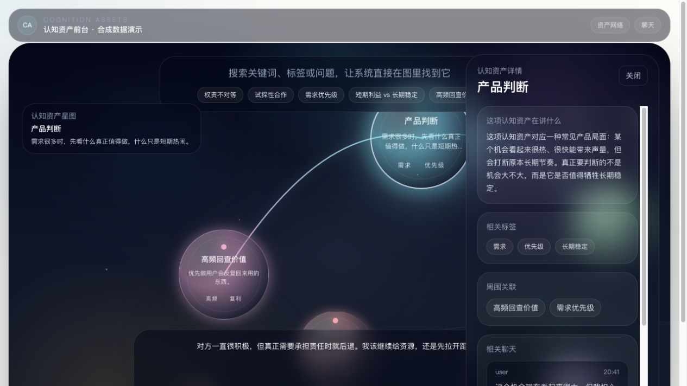

# 个人判断系统 Demo

**聊过的好想法，能不能变成下次遇事时找得到、用得上的判断？**

基于 Next.js、TypeScript 和 Tailwind CSS 的演示项目，把聊天、问题、母题、原则、方法、案例和来源组织在同一个界面中。

## 界面演示

合成数据演示，展示观点、经验与判断之间的联系。



## 为什么做这个

聊天记录容易保存，判断方法却容易埋在长对话里。想回查“当时为什么这样决定”，通常还得重新翻找。这个 Demo 尝试把对话里值得复用的内容整理成卡片与关系地图，保留来源，便于再次思考和修正。

它验证的是信息组织与操作体验，尚未实现一个可直接托管真实个人记忆的生产系统。

## 先看哪些页面

| 页面 | 用途 |
|---|---|
| / | 查看认知资产概况 |
| /knowledge-tree | 浏览判断地图与节点关系 |
| /nodes/principle-001 | 看一项原则的解释、证据和关联 |
| /chat | 看聊天与资产整理的演示界面 |
| /import | 看上传、解析、分析的演示流程 |

所有预置数据都是示例，不是作者真实聊天、客户案例或资产数量。公开版固定使用 mock 数据；更改环境变量也不会接入作者数据库。

## 运行

需要 Node.js 22 或以上：

```sh
npm ci
npx prisma generate
npm run demo
```

打开 <http://127.0.0.1:3000>。`127.0.0.1` 指向自己的电脑；启动命令默认只监听本机。想开发可用 `npm run dev`。

Prisma 类型生成用于已有服务接口的编译；演示运行不需要 PostgreSQL 或数据库凭证。不要运行数据库迁移或把真实聊天导入这个公开演示版。

## 当前范围与注意点

- 首页、地图、节点、聊天、知识卡片和导入流程使用演示服务；分析器是 mock，不调用真实大模型，不需要 API Key。
- 部分导入操作只展示任务状态与示例解析，不能当作可靠备份、真实分析或永久保存工具。
- 尚无用户登录、隔离、加密、备份和正式的权限控制；不要直接把它开放到公网收集用户聊天。
- 页面中的原则与案例用于展示，不代替个人判断。来源、外部观点和自己的立场仍需区分。
- 如自行接入模型，需由使用者配置服务器端 API，明确哪些内容会上传，并完成权限和隐私设计。仓库不附作者接口或密钥。

## 配套 Skill、许可与联系

[judgment-asset-organizer](skills/judgment-asset-organizer/SKILL.md) 帮助把已授权材料整理为有来源的判断资产，区分事实、解释和待验证推断。它不意味着 Demo 已实现自动分析。

原创源码采用 MIT；Next.js、Prisma、Tailwind 等依赖使用各自许可证。作者 [shane-lin67](https://github.com/shane-lin67)，反馈请到 [Issues](https://github.com/shane-lin67/personal-judgment-demo/issues)。
